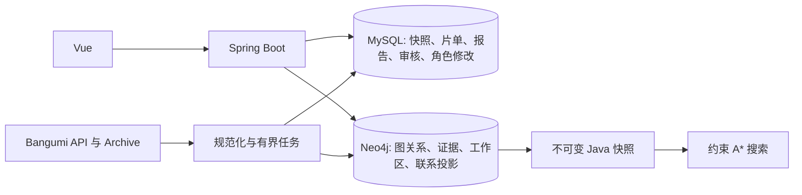

# 数据模型

同步日期：2026-10-24。SQL V1—V10，Neo4j V001—V005；不回写已执行迁移。

## 数据流

联系探索在 Java 快照执行含作品/版本/历史的约束搜索，不是调用数据库内置最短路。Neo4j 承担持久图、关系证据及投影发布。

## 身份与事实

来源 UID 为 `{anime|person|character}:{source}:{sourceId}`，同名不合并。本地实体使用独立 UUID，不按姓名补来源身份。关系无来源 ID 时按规范化字段生成稳定摘要。

制作参与、角色出场、配音和剧情分开。配音保留作品、语言和版本；未知不猜日语。剧情保留类型、方向、剧透、结束状态及原始证据。名称项保存语言、来源、类型与审核状态，未知语言为 und。

## MySQL

| 迁移 | 数据 |
|---|---|
| V1—V2 | 系统账号/角色、导入任务/记录、操作日志 |
| V3 | viewer_binding、viewer_collection；浏览器作用域片单 |
| V4 | 公共元数据快照与任务 |
| V5 | 报告、推荐候选与账号反馈 |
| V6—V8 | 外部身份、审核事件、版本绑定的来源名称 |
| V9 | saved_anime；标准化 payload、前一版、任务状态及错误 |
| V10 | character_edit、character_edit_backup；独立修改与备份 |

个人绑定以浏览器随机 Cookie 摘要隔离，片单不写公共图，个人 Token 不落库。报告发布绑定账号修订及片单版本，旧任务不能覆盖换号后的数据。

来源角色修改使用独立覆盖层；按范围保存通用/本作头像，409 保护并发。它与本地工作区存储和导出格式不同。

## Neo4j

| 模型 | 内容 |
|---|---|
| 基础图 | Entity:Anime/Person/Character，PARTICIPATED_IN、APPEARS_IN、VOICED、RELATED_TO、CHARACTER_RELATION |
| 世界观 | Universe、Series、RelationAssertion、Evidence 及来源/范围关联 |
| 审核批次 | EvidenceImportBatch，摘要、来源、维护者、停用和撤回 |
| 本地编辑 | LocalGraphWorkspace、LocalGraphEntity、LocalGraphBackup；格式 2 |
| 联系投影 | ConnectionCharacter、ConnectionVoiceActor、ConnectionRevision、ConnectionActive，CONNECTION_VOICE、CONNECTION_STORY、CURRENT |

世界观 generation 原子切换，审核证据独立保留；网络与分析固定同一版本。联系投影保存完整载荷及类型化图，成功才切换 CURRENT，保留最近两版；运行查询持有旧快照。

## 一致性

保存先写 SQL，再幂等写图；失败为 PARTIAL，保留有效资料并可重放，不保证跨库 ACID。来源刷新保护人工字段及停用状态，不把来源缺席当删除。

身份、别名、事件和 SQL 审计同事务；证据批次与图发布同 Neo4j 事务，附加 SQL 审计不是跨库原子提交。本地编辑自动备份和版本控制见[角色图谱](角色关系图谱.md)，约束寻路见[联系探索](角色联系探索.md)。
