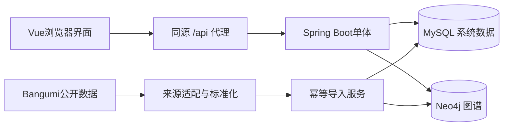
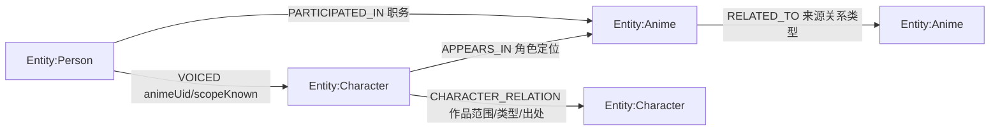
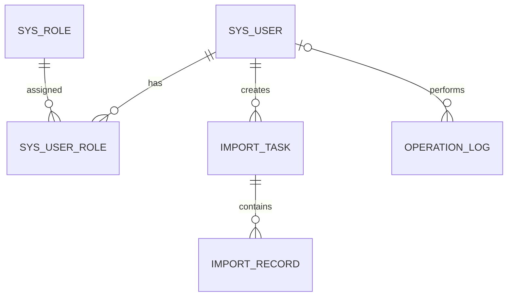
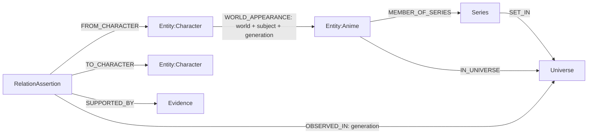

> 2026-10-23当前方向更正：精选产品及固定20部限制已移除；本地与在线统一作品流程。以下旧条目仅为历史记录，以《本次方向收敛与验收》《统一作品数据与部署说明》和当前用户要求为准。

# 数据模型

10月23日来源/恢复接续：契约0.18.0，122后端/86前端及6项实际数据库通过；20部来源差异可查，7,486条冻结关系齐全。同机独立两库逻辑恢复与图重开验证通过。三组12候选仍待独立审核。见[当前逐项状态](完整改进实施记录10.23.md)、[来源](精选来源核对与差异检查10.23.md)及[恢复](独立数据恢复验收10.23.md)，下文接续记录保留历史范围。

10月23日接续：人员报告viewing-report/2已支持总体/职务、全片单/精选交集和本地资料复用；覆盖完整性与新鲜度分离。全量115后端/86前端及4项实际数据库场景通过，契约0.17.0，Release与20部读取通过。详见[本轮逐项状态](完整改进实施记录10.23.md)和[报告口径](人员总体报告与资料复用.md)，总计划尚未整体验收。

2026-10-23补充：精选成员由data/curated/local-library.v1.json的稳定UID和SHA256版本定义，随JAR发布，不用图库全体Anime数量代替。旧历史作品及共享Person/Character保留。未修改Flyway V1—V8或Neo4j历史迁移；本轮仅新增应用层清单校验、分组计数与写入范围保护，参见[实施记录](完整改进实施记录10.23.md)。

2026-10-22别名增量：MySQL V8增加external_identity_name，按身份ID/序号保存名称、规范化检索键、语言、独立依据、目标UID、来源URL/修订/许可及审核版本。公开查询须身份为REVIEWED且当前版本/目标一致；NAMES替换事件保存前后名称快照，与身份版本和操作日志同事务。撤回、重开及改绑后旧名称保留但不参与检索；详见[别名模型](已审核来源别名与检索.md)。

此前0.14.0身份候选增量：既有`external_identity.match_method`增加流程值`TITLE_ONLY`，表示仅有页面标题元信息；不能直接审核。补充不同的核验文字及完整来源资料后变为`MANUAL`候选，仍须另行审核。方法变化随身份版本、前后快照和审计日志同事务保存；不新增数据库迁移、不自动创建缺少的目标实体，详见[覆盖抽样与候选清单](外站覆盖抽样10.22.md)。

2026-10-18补充：MySQL V3增加viewer_binding与viewer_collection。前者以浏览器随机Cookie的SHA256摘要为主键，保存Bangumi用户资料及同步状态；后者以viewer_id/subject_id为复合主键，保存观看状态、个人评分、个人及社区标签等片单资料。个人片单不写入全局Neo4j，令牌不落库。旧sys_user等表保留为维护历史，普通用户不再依赖本地账号。具体口径见[当前项目方向](./项目新方向与实施路线.md)。

实体、属性、导入语义的规范依据为`Codex分步实施指南.md`第4节。本文将实现约束固定为S03—S13的输入。

## 架构

## 图谱

实体UID：`{anime|person|character}:{source}:{sourceId}`。source固定小写白名单；sourceId作为字符串处理。不允许前端传入标签或Cypher。所有实体有Entity标签和唯一uid；名称不是唯一键。

关系UID：来源已有稳定ID时规范化使用；否则对source、关系类型、起终点UID、规范化限定字段构成的JSON数组做SHA-256，输出`relation:{hash}`。业务限定字段次序固定：PARTICIPATED_IN使用roleCode；APPEARS_IN不以显示角色定位制造身份；VOICED使用animeUid或空值、language或空值、versionLabel或空值；RELATED_TO使用relationCode。

同关系类型只允许固定端点组合。额外属性使用白名单，禁止覆盖uid、source、createdAt和手工维护字段标记。

## 配音与计数

- 作品范围明确的配音必须指向有效作品且角色通过有效APPEARS_IN出场。
- 未知范围配音不参与作品配音表、共同声优和通用路径。
- 制作统计仅依据PARTICIPATED_IN，去重作品UID，不对多个职务重复计数。
- 通用路径首版只有PARTICIPATED_IN、APPEARS_IN和RELATED_TO，1—4跳，忽略探索方向但显示真实边方向；节点不能重复。
- 合作网络为中心人员到合作者的星形图，边权是不同共同作品数量。
- 用户新增的角色剧情边为CHARACTER_RELATION，relationCode采用Bangumi官方28类，兼容旧TEAMMATE/MENTOR；按作品限定并保存出处、剧透及结束状态，依据共享字典保留方向及规范化无方向端点。它不参与制作统计，也不自动进入原有通用路径。详见`角色关系图谱.md`。

## 系统数据

S03须生成真实DDL，最小字段见指南4.3。使用utf8mb4、UTC时间、用户名唯一、用户角色联合唯一和task_id+record_key唯一。日志保留执行者ID及显示快照，账号首版启停而不物理删除。

导入图写入与MySQL任务记录采用幂等重放恢复，不使用跨库原子事务。图写入单实例串行化同业务键，避免导入与后台创建关系发生竞态。任务统计从记录终态汇总，不按尝试次数累加。

## 维护与同步

- 所有实体和关系逻辑停用；公共查询及统计过滤停用内容。
- 人工修订字段进入manualFields，来源增量更新保留这些字段。
- 来源撤销关系由管理员核实后停用，首版不把导入包未出现记录视为删除。
- 人工新建数据source=manual；fixture数据用于测试；bangumi数据必须可追溯。
- 原始嵌套结构保存在原始文件，Neo4j属性不保存任意嵌套对象。

## 2026-10-21 增量模型

既有实体UID、Entity标签、人工字段及旧关系不重建。MySQL新增迁移V4—V6；Neo4j新增V002唯一约束，经既有模式初始化器接续执行。

| 存储 | 新增内容 | 归属/一致性 |
|---|---|---|
| MySQL | public_credit_snapshot、public_metadata_task | 公共作品×CAST/STAFF分页JSON；页数/完整性/来源版本单独解释，任务有界，重启后终止遗留运行态 |
| MySQL | viewer_report | 绑定修订+lastSyncedAt版本；INSERT SELECT条件发布；换账号/解绑清理，不写入公共接口 |
| MySQL | recommendation_candidate | 公共候选payload、采集时间、datasetVersion；只有当前已验证版本参与排序 |
| MySQL | viewer_recommendation_feedback | 当前本机关联的排除/恢复；不修改Bangumi远端收藏 |
| MySQL | external_identity | provider+entity_type+区分大小写provider_id唯一；V7新增id、version、核验原文、理由及维护者，支持候选审核/改绑 |
| MySQL | external_identity_event | 身份变更前后JSON快照、操作、维护者、理由及时间；与身份、operation_log同一事务 |
| Neo4j | Universe、Series、RelationAssertion、Evidence | uid唯一；复杂关系多证据独立表达；active过滤，不把证据条数当关系条数 |
| 浏览器 | 历史与头像设置 | 历史按public/账号隔离；头像最多200项，按实体+图片URL+自然尺寸绑定；同URL同尺寸的内容替换无法由此指纹识别 |

世界观先写新generation，再切activeGeneration指针；读取节点/关系使用同一固定代际。首批实际资料均为GLOBAL；按季筛选不推断关系在本季发生，严格范围不显示GLOBAL。接续导入支持有原文证据的SUBJECT_EXPLICIT；身份额外包含世界观及排序后的作品ID，防止不同范围事实合并。不同方向和类型不合并；同一断言多个来源保留Evidence。active只在新建时设为true，刷新不直接重启已停用证据。

V003新增`EvidenceImportBatch.uid`唯一约束；批次以`INCLUDES_EVIDENCE`关联证明，保存内容摘要、规范化包、来源版本、维护账号和提交/停用时间。批次与证据单次Neo4j事务发布，批次不依赖MySQL任务状态。MySQL操作日志为附加记录。已审核断言以固定`REVIEWED`观察代际关联世界观，公共名册换代不删除审核证明。

世界观`evidenceRevision`随导入、停用、撤回更新，包含所有受共享事实影响的世界观。网络版本为`activeGeneration|evidence:revision`，读取期间变更最多重试一次，持续变化返回409；分析可要求匹配画布版本。共享证明仅在最后有效批次停用后置为inactive，同证据重放不恢复；断言撤回则阻止整个关系复活。见[维护说明](关系证据审核与批次维护.md)。

2026-10-22身份审核使用`id + version`乐观并发；更新状态、前后快照和MySQL操作日志原子提交。改绑回到CANDIDATE，驳回/撤回必须提供新修订显式重开；种子遇已有来源键不再改写维护数据。公开查询隐藏REJECTED/REVOKED。身份对应关系不自动迁移图内事实，不假设跨数据库事务，见[身份维护](跨来源身份审核与改绑.md)。
